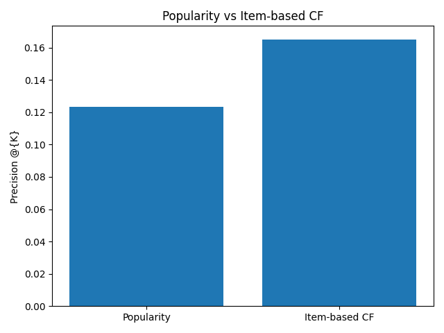

# Movie Recommender: Popularity Baseline vs Item-Based Collaborative Filtering

A small learning project that compares a popularity baseline with item-based collaborative filtering (cosine similarity) on the MovieLens ml-latest-small dataset, using offline evaluation.

## Data

MovieLens ml-latest-small (GroupLens Research): about 100K ratings from 610 users on about 9.7K movies. It is a development dataset and is not intended for reporting research results.

The data files are not included in this repo. Download `ml-latest-small.zip` from https://grouplens.org/datasets/movielens/latest/ and place `ratings.csv` and `movies.csv` in the project folder.

## Method

1. Kept movies with at least 20 ratings (67,898 ratings, 610 users, 1,297 movies); random 80/20 train/test split (54,318 train, 13,580 test).
2. **Popularity baseline:** top movies by number of ratings of 4 or higher in the training set.
3. **Item-based CF:** cosine similarity between movies; each unseen movie is scored by similarity to the user's rated movies.
4. **Evaluation:** Precision@10 and Recall@10, where a "liked" movie is a test rating of 4 or higher. Movies a user already rated in training are excluded from recommendations. 586 users had at least one liked movie in the test set and were evaluated.

## Results

| Model | Precision@10 | Recall@10 |
|---|---|---|
| Popularity | 0.1232 | 0.1204 |
| Item-based CF | 0.1652 | 0.1916 |

Item-based CF outperformed the popularity baseline on both metrics in this single random split (586 users evaluated). No significance testing was done.



## Limitations

- Offline evaluation on a single random split; no real-user testing or confidence intervals.
- Only movies with at least 20 ratings were used, so results do not apply to less-rated movies.
- Unrated movies are treated as zeros in the similarity calculation.
- No hyperparameter tuning or other methods (e.g. matrix factorization).
- Cannot handle new users or movies (cold start).

## Run it

```
pip install pandas numpy scikit-learn matplotlib
```

Then open `recommender.ipynb` and run all cells.

## Tools

Python, pandas, NumPy, scikit-learn, Matplotlib
